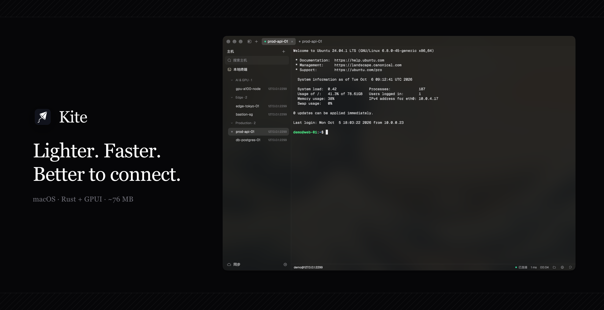
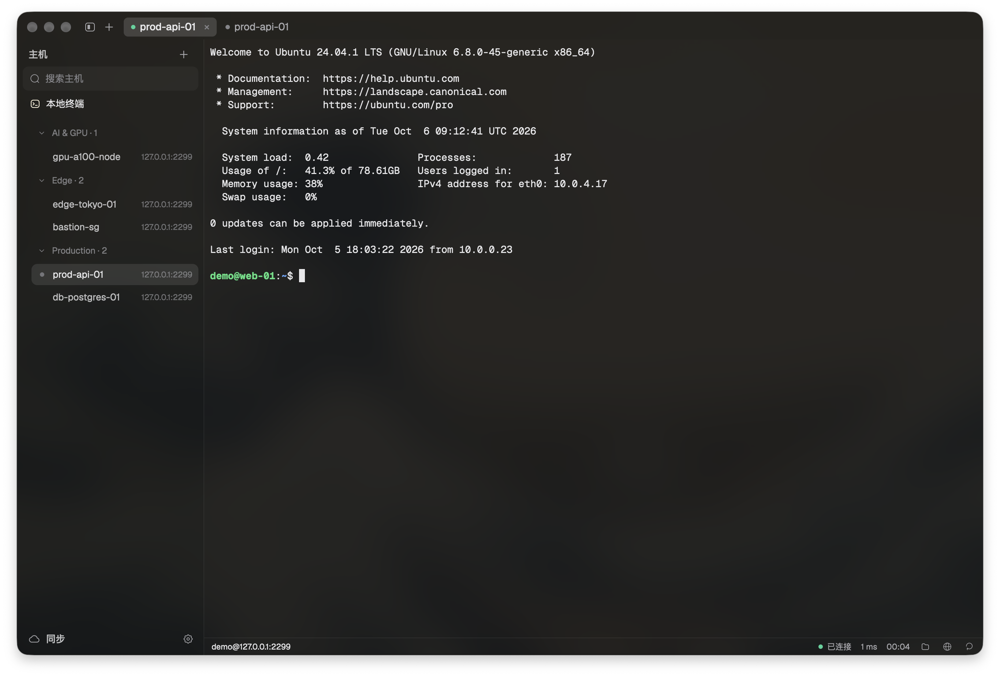
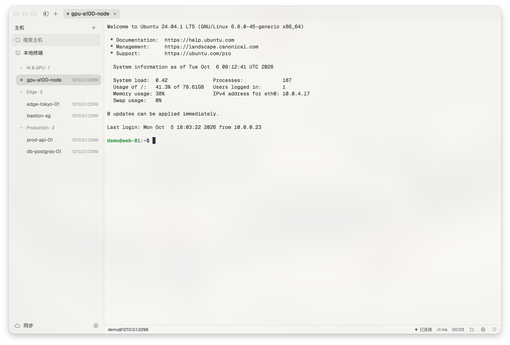
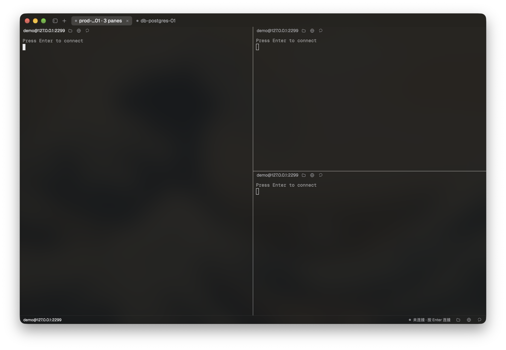
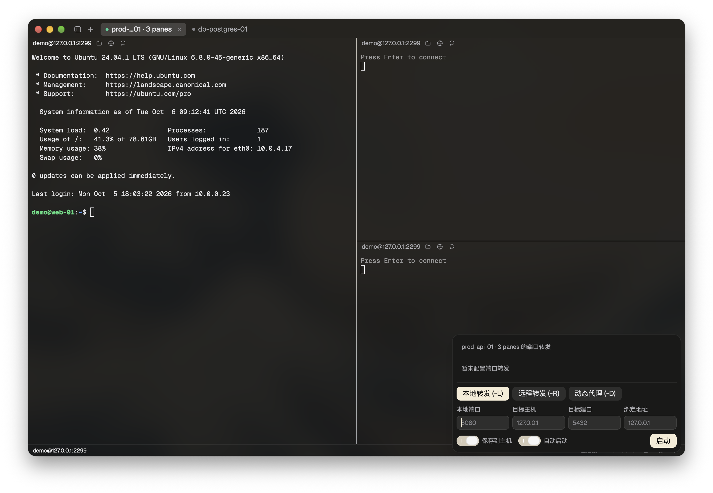

<p align="center">
  
</p>

<h1 align="center">Kite</h1>

<p align="center">
  基于 Rust 与 <a href="https://github.com/zed-industries/zed/tree/main/crates/gpui">GPUI</a> 构建的 macOS 原生 SSH 客户端。<br>
  Termius / Netcatty 的高性能、高颜值、低内存占用开源替代方案。
</p>

<p align="center">
  <a href="LICENSE"></a>
  
</p>

<p align="center">
  
</p>

<details>
<summary>更多界面预览（深色 / 浅色主题 / 多窗格分屏 / 端口转发）</summary>

<p align="center">
  
</p>

<p align="center">
  
</p>

<p align="center">
  
</p>

<p align="center">
  
</p>

</details>

---

## 为什么选择 Kite

市面上主流的 SSH 客户端（如 Termius、Netcatty、Tabby）大多基于 Electron，开几个标签页内存动辄五六百 MB。

**Kite** 用纯 **Rust** 编写，底层采用 **GPUI** GPU 渲染、**russh** 异步 SSH 和 **alacritty_terminal** 终端内核，轻快、省内存、颜值在线：

### 实测内存对比（macOS 活动监视器同口径）

| 客户端 | 状态 | 内存占用 |
| :--- | :--- | :--- |
| **Kite（无壁纸）** | 连着 1 个 SSH 会话 | **~76 MB** |
| **Kite（开壁纸）** | 连着 1 个 SSH 会话 | **~125 MB** |
| **Tabby** | 空载 / 连着 1 个会话 | ~471 MB / ~580 MB |
| **Termius** | 空载 | ~583 MB |
| **Netcatty** | 运行中（5 进程合计） | ~1,005 MB |

### 主要特点

- **轻快不卡顿**：GPU 加速渲染，支持触控板和鼠标滚轮平滑滚动；服务器狂刷大日志时也不会把内存吃爆。
- **高颜值原生界面**：内置多款名画壁纸，能自动提取壁纸色调适配界面；支持明暗主题自动跟随系统、自定义字体和半透明背景。
- **日常功能齐全（基本完整覆盖 Netcatty）**：
  - `⌘K` 快速连接、分组与标签管理、`~/.ssh/config` 一键导入
  - 支持 **SOCKS5 / HTTP 代理 / ProxyCommand / 跳板机（ProxyJump）**
  - 自由拖拽分屏（`⌘D` / `⌘⇧D`）、标签页拆窗、滚动条自动隐藏与拖拽
  - 内置 **SFTP** 侧边栏，支持浏览目录、下载和拖拽上传
  - **Snippets** 快捷命令片段（`⇧⌘S`）、端口转发（Local / Remote / SOCKS）
  - **本地加密保险箱（age）**：支持 PIN / 系统钥匙串解锁、外部密码管理器联动、`⌘\` 一键填 `sudo` 密码
  - 支持加密同步到你自己的私有 Git 仓库，不用注册账号、不用开会员

## 下载与安装

可直接前往 [Releases](https://github.com/Kfkcome/kite/releases) 下载对应平台构建产物（macOS Apple Silicon 请下载 `*-macos-arm64.zip`）。

> **macOS 首次打开提示说明**
> 由于当前版本未接入付费 Apple Developer 商业签名与公证，从浏览器下载后首次打开可能会触发 macOS Gatekeeper 拦截，任选以下一种方式即可永久放行：
> - 将 `Kite.app` 拖进 `/Applications` 后，在终端执行一次：`xattr -cr /Applications/Kite.app`
> - 或者打开一次后前往 **系统设置 → 隐私与安全性** 点击 **“仍要打开”**（通过 Homebrew Cask 安装也可使用 `--no-quarantine` 自动跳过）

## 构建与运行

目前支持 **macOS**，需要安装 Rust 工具链（见 [docs/building.md](docs/building.md)）：

```sh
# 运行开发版
cargo run -p kite

# 构建 macOS .app 应用包（输出至 target/release/bundle/Kite.app）
./scripts/bundle-app.sh
```

## 致谢

- 本项目基于开源项目 **tern** 持续演进与二次开发
- 感谢 **[LINUX DO](https://linux.do)** 社区及所有反馈与支持的朋友

## 开源协议

本项目采用 **[GNU General Public License v3.0 or later (GPL-3.0-or-later)](LICENSE)** 开源协议。

第三方依赖与衍生代码声明见 [NOTICE.md](NOTICE.md)。
